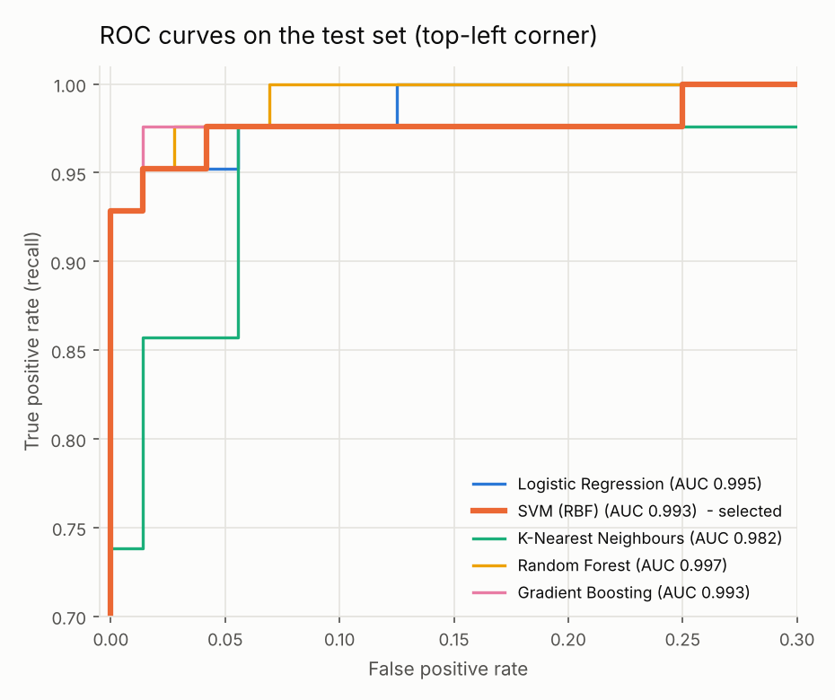
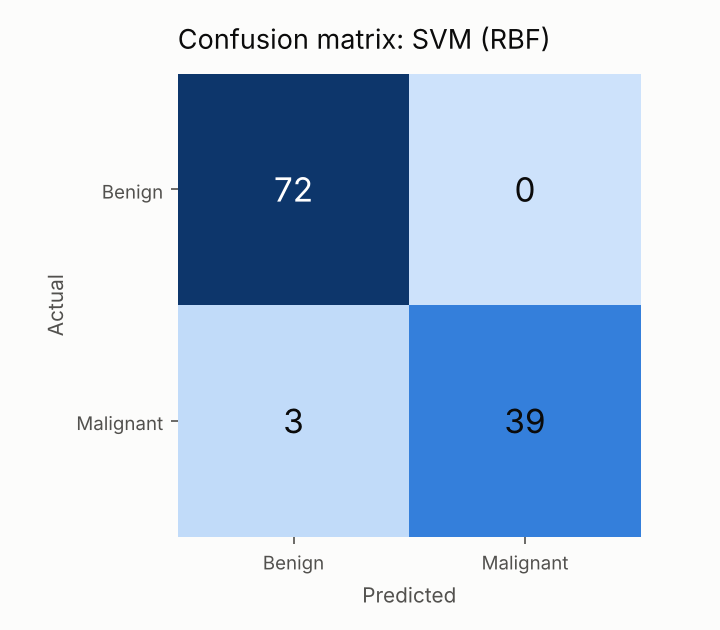
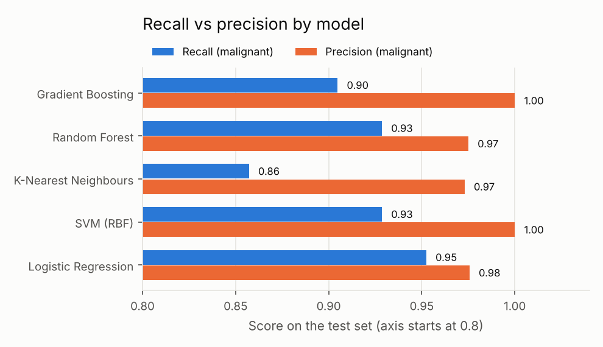
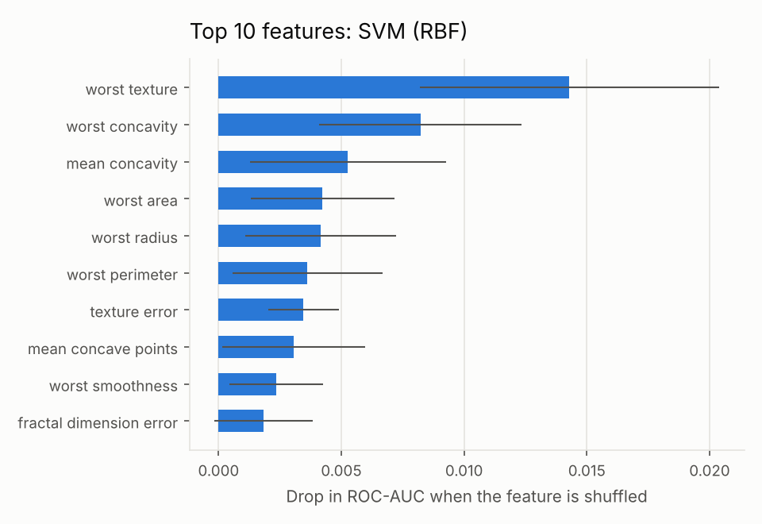
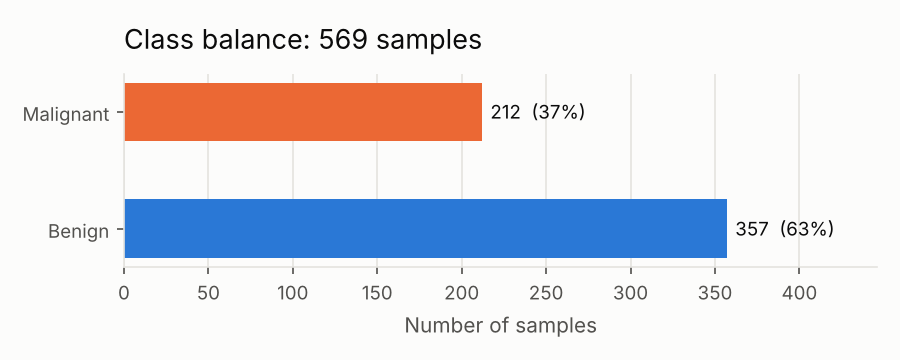

# Breast Cancer Diagnosis – End-to-End Machine Learning Project

[](https://github.com/puppalamukesh/breast-cancer-diagnosis/actions/workflows/ci.yml)


A complete machine learning workflow for classifying breast masses as **malignant** or **benign**:
data loading, cross-validated model comparison with hyperparameter tuning, evaluation with charts,
a **FastAPI** prediction service, automated tests, Docker, and GitHub Actions CI.

> **Note:** this is a learning and portfolio project, not a medical device. It must not be used for real diagnosis.

## Results

Five models were tuned with 5-fold stratified cross-validation on the training set (455 samples).
The model with the best cross-validated **F2-score** was selected, then evaluated once on the held-out test set (114 samples).

**Selected model: SVM with RBF kernel** (C = 10, gamma = "scale")

| Metric (test set) | Score |
|---|---|
| Accuracy | 97.4% |
| Precision (malignant) | 100% |
| Recall (malignant) | 92.9% |
| ROC-AUC | 0.993 |

Out of 42 malignant cases in the test set, 39 were detected and 3 were missed. No benign case was flagged as malignant.

| Model | CV F2 | CV ROC-AUC | Test recall | Test precision | Test accuracy |
|---|---|---|---|---|---|
| **SVM (RBF)** | **0.965** | 0.993 | 0.929 | 1.000 | 0.974 |
| Gradient Boosting | 0.961 | 0.993 | 0.905 | 1.000 | 0.965 |
| Logistic Regression | 0.960 | 0.995 | 0.952 | 0.976 | 0.974 |
| Random Forest | 0.954 | 0.989 | 0.929 | 0.975 | 0.965 |
| K-Nearest Neighbours | 0.946 | 0.989 | 0.857 | 0.973 | 0.939 |

<p>
  
  
</p>
<p>
  
  
</p>

## Dataset

[Breast Cancer Wisconsin (Diagnostic)](https://archive.ics.uci.edu/dataset/17/breast+cancer+wisconsin+diagnostic),
loaded through scikit-learn (no download needed).

- 569 samples: 212 malignant (37%), 357 benign (63%)
- 30 numeric features computed from images of cell nuclei: radius, texture, perimeter, area, smoothness,
  compactness, concavity, concave points, symmetry and fractal dimension, each as mean, standard error and worst value
- No missing values



## Design decisions

**Malignant is the positive class.** scikit-learn labels malignant as 0. The labels are flipped so that recall
and precision describe how well the model finds cancer, which is the question that matters.

**Models are selected on F2, not accuracy.** Missing a malignant tumour (false negative) is much worse than a
false alarm. The F2-score weights recall twice as much as precision. Recall alone is not used for selection,
because a model that calls every sample malignant would score a perfect 1.0.

**Everything is a scikit-learn Pipeline.** Scaling is fitted inside each cross-validation fold, so no
information from the validation folds leaks into training.

**The test set is touched once.** All tuning and model selection use cross-validation on the training data.
The test set is only used for the final numbers above.

**The SVM is calibrated.** `SVC` does not produce probabilities by itself, so it is wrapped in
`CalibratedClassifierCV` (Platt scaling). The API can then return a probability, not just a label.

**Selection uses CV, even if another model looks better on the test set.** Logistic Regression has a slightly
higher test recall (0.952 vs 0.929). With only 42 malignant test cases that is a difference of one patient, so
the more stable cross-validation score decides.

## Project structure

```
breast-cancer-diagnosis/
├── src/bcd/
│   ├── config.py      # paths, random seed, selection metric
│   ├── data.py        # load and split the dataset
│   ├── models.py      # 5 candidate pipelines + hyperparameter grids
│   ├── train.py       # grid search, model selection, saves model and reports
│   ├── evaluate.py    # test metrics and charts
│   ├── predict.py     # load the saved model, predict (Python + CLI)
│   └── api.py         # FastAPI service
├── tests/             # pytest: data, training, API
├── reports/           # metrics.json, model_comparison.csv, figures/
├── models/            # trained model (created by training, not committed)
├── .github/workflows/ci.yml
├── Dockerfile
├── Makefile
└── pyproject.toml
```

## Getting started

Requires Python 3.11 or newer.

```bash
git clone https://github.com/puppalamukesh/breast-cancer-diagnosis.git
cd breast-cancer-diagnosis
python -m venv .venv
source .venv/bin/activate        # Windows: .venv\Scripts\activate
pip install -r requirements-dev.txt
pip install -e .
```

**Train** (about 30 seconds). This saves `models/model.joblib` and refreshes everything in `reports/`.

```bash
python -m bcd.train
```

**Predict** one sample from the dataset:

```bash
python -m bcd.predict --sample 0
# Sample 0: predicted malignant (p = 0.954), actual malignant
```

**Run the tests:**

```bash
pytest
```

## Prediction API

```bash
uvicorn bcd.api:app --reload
```

Then open <http://127.0.0.1:8000/docs> for the interactive Swagger page.

| Method | Endpoint | Description |
|---|---|---|
| GET | `/health` | Service status |
| GET | `/model-info` | Selected model, training date and test metrics |
| POST | `/predict` | Predict one sample (30 features) |
| POST | `/predict/batch` | Predict up to 100 samples |

Example response from `/predict`:

```json
{ "prediction": "malignant", "probability_malignant": 0.9542 }
```

The request is validated: all 30 features are required and none can be negative. Invalid input returns HTTP 422.

### Docker

```bash
docker build -t breast-cancer-diagnosis .
docker run --rm -p 8000:8000 breast-cancer-diagnosis
```

The model is trained during the image build, so the container is ready to serve when it starts.

## Continuous integration

Every push runs GitHub Actions on Python 3.11 and 3.12: linting with **ruff**, the **pytest** suite, and a quick
training and prediction run.

## Next steps

- Tune the decision threshold (currently 0.5) to push recall higher at an acceptable precision cost
- Add SHAP values to explain individual predictions
- Track experiments with MLflow
- Build a simple web front end for the API

## Author

**Mukesh Puppala**, MSc Data Science, AI and Digital Business, Gisma University of Applied Sciences, Berlin
[LinkedIn](https://www.linkedin.com/in/mukesh-puppala-73b08a22a) · [GitHub](https://github.com/puppalamukesh)

Dataset: W. N. Street, W. H. Wolberg and O. L. Mangasarian, UCI Machine Learning Repository.
